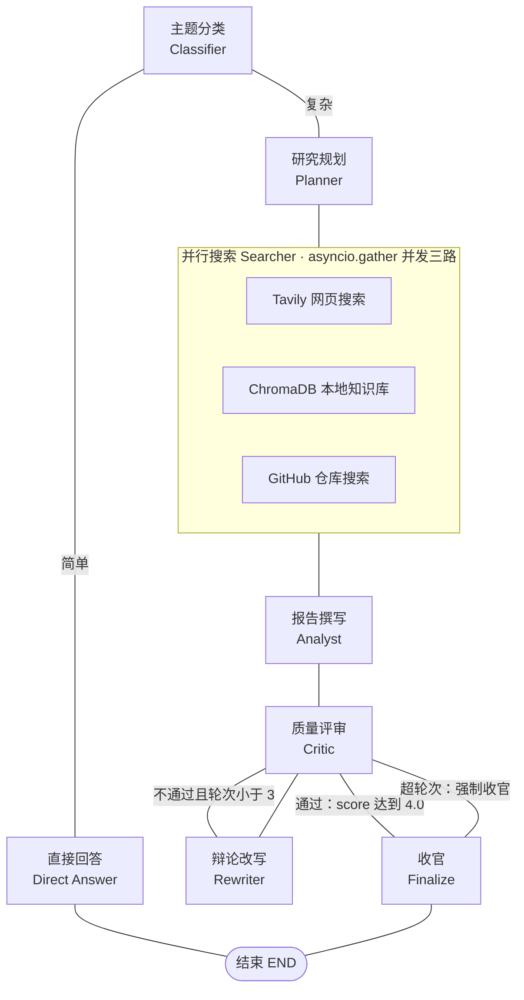
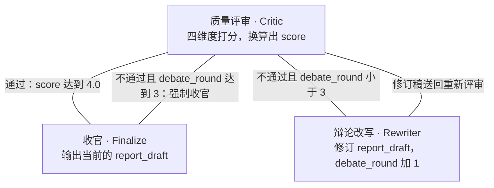

# 四 Agent 协作研究系统

<p align="center">
  <b>基于 LangGraph + DeepSeek 的多 Agent 协作研究系统</b>
  <br>
  <i>自然语言驱动 · 多源并行搜索 · 辩论式质检 · 报告自动生成</i>
</p>

<p align="center">
  
  
  
  
  
</p>

---

## 📋 目录

- [项目概述](#-项目概述)
- [名词口径](#-名词口径)
- [系统架构](#-系统架构)
- [三种执行路径](#-三种执行路径)
- [辩论回环](#-辩论回环)
- [Agent 与节点分工](#-agent-与节点分工)
- [共享状态](#-共享状态)
- [技术特色](#-技术特色)
- [前置条件](#-前置条件)
- [快速开始](#-快速开始)
- [使用指南](#-使用指南)
- [本地知识库](#-本地知识库)
- [项目结构](#-项目结构)
- [技术栈](#-技术栈)
- [已知限制与注意事项](#-已知限制与注意事项)

---

## 🎯 项目概述

输入一个研究主题，系统自动完成 **分类 · 规划 · 并行搜索 · 分析 · 辩论质检** 全流程，输出结构化 Markdown 研究报告。简单问题绕过整条流水线直接回答。

**核心能力：**

| 能力 | 说明 |
|------|------|
| 🧠 **智能分流** | 分类器判断问题难易：简单问答直接回复，复杂课题进入完整研究流水线 |
| 📋 **自动规划** | 将研究主题拆解为子问题、提取搜索关键词、标注搜索深度与来源要求 |
| 🔍 **多源并行搜索** | `asyncio.gather` 同时搜索网页（Tavily）、本地知识库（ChromaDB）、GitHub 开源仓库 |
| 📝 **报告生成** | 基于收集到的资料撰写含摘要、正文、结论的 Markdown 报告，论断标注来源 |
| 🔎 **辩论式质检** | 评审 Agent 四维度评分，不达标则打回改写，最多改写 3 轮 |
| 💬 **双入口** | CLI 命令行 + Gradio Web 聊天界面，均支持流式进度展示 |
| 🗃️ **本地知识库 RAG** | 将 arXiv 论文 LaTeX 源码构建为 ChromaDB 向量库，按 section 层级检索并展开上下文 |

---

## 📐 名词口径

代码里 `research_system/agents/` 下有 6 个模块，LangGraph 图里还有 1 个透传收官节点。为避免歧义，本 README 统一使用以下说法：

| 说法 | 指代 | 个数 |
|------|------|------|
| **四个研究 Agent** | Planner、Searcher、Analyst、Critic —— 构成研究主管线 | 4 |
| **入口路由器** | Classifier —— 只做分类决策并分流，不产出研究内容 | 1 |
| **辩论改写器** | Rewriter —— 仅在评审不通过时触发，服务于 Critic 构成回环 | 1 |
| **图节点** | 上述 6 个 + `direct_answer`（简单出口）+ `finalize`（透传收官） | 8 |

标题沿用项目既有叫法「四 Agent」（与 `main.py` 启动横幅、Gradio 页面标题、`docs/` 设计文档一致）。

---

## 🏗️ 系统架构

系统由 **LangGraph `StateGraph`** 编排，共 8 个图节点，节点间通过条件边实现路由分流与辩论回环。



> 图中全部采用**无箭头连线**，方向由自上而下的布局与连线上的标签表达。
> `Critic` 与 `Rewriter` 之间的两条连线构成**辩论回环**，最多绕 3 圈，详见 [辩论回环](#-辩论回环)。
> 简单路径的结果在 `final_report`，复杂路径的结果在 `report_draft` —— 两个字段不要混用，见 [共享状态](#-共享状态)。

---

## 🛤️ 三种执行路径

同一个入口，按分类结果与评审结果分流成三条路径。下方三条泳道均自左向右阅读，公共前缀（分类）在三条道里各自画出，便于对比长度差异：


**A** 最短，只有一次 LLM 调用；**B** 走完整流水线但不回环；**C** 在 B 的基础上插入「改写—重评」循环，收尾条件见 [辩论回环](#-辩论回环)。

---

## 🔁 辩论回环

Critic 每次评审都返回一个 1–5 分（满分 5.0），路由决策完全由 `debate_round` 与通过线决定：



| 条件 | 动作 |
|------|------|
| `score >= 4.0`（`passed = true`） | 判定通过，进入 Finalize 收官，输出当前 `report_draft` |
| `score < 4.0` 且 `debate_round < 3` | 进入 Rewriter 改写，`debate_round` 加 1，然后回到 Critic 重评 |
| `score < 4.0` 且 `debate_round >= 3` | 强制收官，输出当前 `report_draft`（不丢弃已有成果） |

> 计数口径：`debate_round` 由 Rewriter 递增，因此**最多改写 3 次，Critic 最多执行 4 次**。

**四个评分维度**（由 `CRITIC_PROMPT` 定义，返回在 `quality_score.dimensions` 中）：

| 维度 | 字段 | 说明 |
|------|------|------|
| **事实准确性** | `accuracy` | 论断是否有来源支撑，是否存在幻觉 |
| **完整性** | `completeness` | 是否覆盖研究计划中的必要方面 |
| **逻辑一致性** | `consistency` | 前后文是否矛盾，论证是否连贯 |
| **引用质量** | `citations` | 来源是否可靠，引用格式是否规范 |

---

## 🤖 Agent 与节点分工

| 节点 | 角色 | 输入 | 输出 | 实现 |
|------|------|------|------|------|
| **Classifier** | 入口路由器 | `topic` | `is_complex` | `agents/classifier.py:6` |
| **Direct Answer** | 简单出口 | `topic` | `final_report` | `agents/classifier.py:22` |
| **Planner** | 研究 Agent 1 | `topic` | `plan`（4 字段结构化 JSON） | `agents/planner.py:26` |
| **Searcher** | 研究 Agent 2 | `plan.keywords` + `plan.sub_questions` | 去重合并后的 `sources[]` | `agents/searcher.py:15` |
| **Analyst** | 研究 Agent 3 | `sources[]` | `report_draft` | `agents/analyst.py:6` |
| **Critic** | 研究 Agent 4 | `report_draft` | `quality_score` + `review_feedback` | `agents/critic.py:27` |
| **Rewriter** | 辩论改写器 | `report_draft` + `review_feedback` | 修订后的 `report_draft` | `agents/rewriter.py:6` |
| **Finalize** | 收官 | 整个 state | 原样透传 | `core/graph.py:23` |

节点间的连线由条件边定义，全部集中在 `core/graph.py`：

| 边 | 类型 | 路由条件 |
|----|------|----------|
| `classifier` 出边 | 条件边 | `is_complex` 为真走 `planner`，否则走 `direct_answer` |
| `planner` | 普通边 | 固定流向 `searcher` |
| `searcher` | 普通边 | 固定流向 `analyst` |
| `analyst` | 普通边 | 固定流向 `critic` |
| `critic` 出边 | 条件边 | 通过走 `finalize`；未通过且未超轮次走 `rewriter`；超轮次走 `finalize` |
| `rewriter` | 普通边 | 固定流回 `critic`，构成回环 |
| `direct_answer` / `finalize` | 普通边 | 固定流向 `END` |

---

## 📦 共享状态

节点之间通过 `ResearchState`（`TypedDict`，定义于 `core/state.py`）传递数据。LangGraph 按节点返回值做浅合并，因此每个节点只更新自己负责的字段。

| 字段 | 类型 | 说明 | 写入者 |
|------|------|------|--------|
| `topic` | `str` | 用户原始输入 | 初始状态 |
| `is_complex` | `bool` | 是否为复杂课题 | Classifier |
| `plan` | `dict` | `{sub_questions, keywords, search_depth, required_sources}` | Planner |
| `sources` | `list[dict]` | `[{title, content, source, url}]`（Chroma 结果另带 `metadata`） | Searcher |
| `report_draft` | `str` | 报告草稿（**复杂路径的最终结果所在**） | Analyst 写入，Rewriter 覆写 |
| `review_feedback` | `str` | 评审意见（自然语言） | Critic |
| `quality_score` | `dict` | `{score, passed, dimensions}` | Critic |
| `debate_round` | `int` | 已完成的改写轮次，从 0 开始 | 初始为 0，Rewriter 加 1 |
| `final_report` | `str` | 最终回答（**仅简单路径使用**） | Direct Answer |
| `history` | `list` | 对话历史 `[{role, content}]` | Web UI 传入（CLI 不传） |
| `progress` | `list[str]` | 进度消息队列，驱动流式输出 | 各节点追加 |
| `search_strategy` | `str` | **预留字段**，已声明并初始化，当前无节点写入 | — |
| `search_evaluation` | `str` | **预留字段**，已声明并初始化，当前无节点写入 | — |

**进度消息**：每个节点在开始和结束时向 `progress` 追加一条带 emoji 的中文消息（如 `🔍 正在通过 Tavily、知识库、GitHub 并行搜索...`）。`core/graph.py` 只向下游 yield 新增的部分，CLI 与 Web 界面据此做流式展示。

---

## ✨ 技术特色

### 🧩 多源并行搜索
Searcher 用 `asyncio.gather` 同时调用三个搜索工具，总耗时由最慢的一路决定，而非串行累加。每个工具受 `.env` 开关独立控制，禁用后不会进入 gather 列表。Tavily 与 Chroma 的阻塞调用通过 `run_in_executor` 包装并设置 15 秒超时；GitHub 搜索走原生 `httpx.AsyncClient`。

### 🔄 辩论式质检
引入「评审—改写」闭环：Critic 给出结构化评分和具体修改意见，Rewriter 逐条改进后再次提交评审。这种同行评议式机制对报告质量有实质提升，同时用「最大轮次 + 强制收官」保证不会无限循环。

### 🧠 智能路由
Classifier 通过一次低温度 LLM 调用判断问题复杂度。简单问答（如「Python 怎么读写文件」）绕过整条流水线直接回答，节省时间和 token；复杂课题（如「2026 年 AI Agent 框架对比」）才进入研究流程。

### 🛡️ 规划 Agent 的多级容错
Planner 采用三级降级：先按模板解析 JSON；失败则要求 LLM 严格重出 JSON；再失败则退化为关键词抽取，并用模板拼出子问题，保证下游 Searcher 始终拿得到 `keywords`。

### 📊 流式进度反馈
`run_research_stream` 以 `stream_mode="updates"` 订阅图执行，逐条 yield 进度消息，最后 yield 完整状态。CLI 逐行打印，Web 界面把进度渲染成代码块实时刷新，避免用户等待期间无反馈。

### 🗃️ LaTeX 感知的知识库构建
`knowledge_builder.py` 不按固定字数盲切：先解析 LaTeX 结构（展开 `\input`/`\include`，按 section 层级建树），再识别 equation / theorem / proof / algorithm 等**原子块**并整体保留不被切开，仅对普通文本按 200–800 token 递归切分。检索时按命中片段所属的层级节点展开上下文再交给 LLM。

---

## 📋 前置条件

1. **Python 3.10+**（代码使用了 `dict | None` 等 3.10 语法）
2. **DeepSeek API Key**（必填）— [申请地址](https://platform.deepseek.com/api_keys)
3. **Tavily API Key**（可选）— 用于网页搜索，[注册地址](https://tavily.com)

---

## 🚀 快速开始

```powershell
# 1. 进入项目目录
cd d:\项目二

# 2. 创建虚拟环境并安装依赖
python -m venv .venv
.\.venv\Scripts\Activate.ps1
pip install -r requirements.txt

# 3. 配置环境变量
Copy-Item .env.example .env
# 编辑 .env 填入 DEEPSEEK_API_KEY
# 如需网页搜索，再按「环境变量」一节补上 TAVILY_API_KEY 与工具开关

# 4. CLI 模式运行
python main.py

# 5. （或）Web 模式运行
python run_web.py
# 浏览器打开 http://localhost:7860
```

> ⚠️ **务必从项目根目录运行。** `CHROMA_PERSIST_DIR` 默认值是相对路径 `./chroma_db`，会相对于**进程工作目录**解析；在 `research_system/` 下启动会另建一个向量库目录。

---

## 🎮 使用指南

### CLI 模式

```powershell
python main.py
```

在提示符后输入研究主题，进度消息会实时打印。结束后输出子问题清单、资料条数、质量评分与辩论轮次，以及最终报告。

### Web 模式

```powershell
python run_web.py
```

浏览器访问 `http://localhost:7860`。界面按「研究进度 / 研究计划 / 搜索结果 / 质量检查 / 最终报告」分区展示，支持多轮对话与清空对话。

示例问题：

```
2026年AI Agent框架有哪些新趋势？        # 复杂课题，走完整流水线
LangGraph和CrewAI有什么区别？           # 复杂课题，走完整流水线
用Python写一个FastAPI的REST API示例     # 简单问题，直接回答
```

### 环境变量

所有配置通过 `.env` 管理（`python-dotenv` 加载）。**实际被 `config/settings.py` 读取的变量如下**：

| 变量 | 默认值 | 必填 | 说明 |
|------|--------|------|------|
| `DEEPSEEK_API_KEY` | 空 | ✅ | DeepSeek API 密钥；为空时调用会失败 |
| `DEEPSEEK_MODEL` | `deepseek-chat` | | 使用的模型名 |
| `TAVILY_API_KEY` | 空 | | Tavily 密钥；为空时网页搜索直接返回空结果 |
| `CHROMA_PERSIST_DIR` | `./chroma_db` | | 向量库持久化目录，**相对进程工作目录** |
| `TAVILY_ENABLED` | `true` | | 网页搜索开关 |
| `CHROMA_ENABLED` | `true` | | 本地知识库检索开关 |
| `GITHUB_ENABLED` | `true` | | GitHub 仓库搜索开关 |

```ini
# .env 示例
DEEPSEEK_API_KEY=sk-your-deepseek-api-key-here
DEEPSEEK_MODEL=deepseek-chat

TAVILY_API_KEY=tvly-your-tavily-api-key

TAVILY_ENABLED=true
CHROMA_ENABLED=true
GITHUB_ENABLED=true

CHROMA_PERSIST_DIR=./chroma_db
```

> `DEEPSEEK_BASE_URL` 固定为 `https://api.deepseek.com/v1`，**不可配置**（`config/settings.py:9`）。
>
> ⚠️ `.env.example` 目前只列了 DeepSeek 两项，Tavily 与工具开关需要按上表手动补写。

### 可调参数

| 参数 | 当前值 | 位置 | 能否用 `.env` 覆盖 |
|------|--------|------|--------------------|
| `QUALITY_PASS_THRESHOLD` | `4.0` | `config/settings.py:23` | ❌ 硬编码常量 |
| `MAX_DEBATE_ROUNDS` | `3` | `config/settings.py:24` | ❌ 硬编码常量 |

调整评审通过线或最大辩论轮次需直接改代码。

---

## 📚 本地知识库

将 arXiv 论文的 LaTeX 源码构建为向量知识库，研究流程中由 Searcher 通过 ChromaDB 检索增强。

**构建与查询：**

```powershell
# 增量模式（默认）：只处理新增论文
python -m research_system.knowledge_builder

# 全量重建模式
python -m research_system.knowledge_builder --no-incremental

# 查询测试
python -m research_system.knowledge_builder query "deep learning"
```

**论文源码准备：** 源码存放在 `research_system/arxiv_math/`，按论文分目录。可用内置下载器抓取：

```python
import asyncio
from research_system.tools.arxiv_downloader import search_arxiv_papers, download_latex_source

async def main():
    papers = await search_arxiv_papers("transformer attention mechanism", max_results=5)
    for p in papers:
        print(await download_latex_source(p["arxiv_id"], p["title"]))

asyncio.run(main())
```

**构建参数**（`knowledge_builder.py` 顶部常量）：切分区间 200–800 token、重叠 50 token、集合名 `latex_papers`。嵌入模型为 `sentence-transformers/paraphrase-multilingual-MiniLM-L12-v2`，通过 **fastembed + ONNX** 运行，无需安装 PyTorch；模型默认从 `hf-mirror.com` 镜像下载。

**工具冒烟测试：** 搜索工具可脱离主流程单独验证：

```powershell
python research_system/test_tools.py "量子计算"          # 三路工具全部测试
python research_system/test_tools.py --single tavily    # 只测某一个
```

---

## 📁 项目结构

```
项目二/
├── main.py                          # 🚀 CLI 入口：交互式研究（流式进度）
├── run_web.py                       # 🌐 Web 入口：启动 Gradio，端口 7860
├── verify_token.py                  # 🔧 调试脚本：核对向量库 metadata 字段
├── requirements.txt                 # 📦 Python 依赖清单
├── .env.example                     # 🔑 环境变量模板（仅含 DeepSeek，Tavily 需自行补）
├── .gitignore
├── README.md
├── 架构详解.md                       # 📄 早期架构说明（部分内容已与实现脱节，见下）
│
├── docs/superpowers/                # 📚 设计文档与实施计划
│   ├── specs/2026-05-19-four-agent-research-system-design.md
│   └── plans/2026-05-19-four-agent-research-system.md
│
├── research_system/
│   ├── core/
│   │   ├── state.py                 # 📦 共享状态定义（ResearchState）
│   │   ├── llm.py                   # 🤖 DeepSeek 客户端封装（OpenAI 兼容 SDK）+ llm_call()
│   │   └── graph.py                 # 🔗 LangGraph 图构建、条件边、流式执行
│   ├── agents/
│   │   ├── classifier.py            # 🧠 入口路由：classify_topic + direct_answer_agent
│   │   ├── planner.py               # 📋 规划 Agent（结构化 JSON + 三级容错）
│   │   ├── searcher.py              # 🔍 搜索 Agent（asyncio.gather 并行三路）
│   │   ├── analyst.py               # 📝 报告撰写 Agent
│   │   ├── critic.py                # 🔎 质量评审 Agent（四维度评分）
│   │   └── rewriter.py              # ✏️  辩论改写 Agent
│   ├── tools/
│   │   ├── tavily_search.py         # 🌐 Tavily 网页搜索
│   │   ├── chroma_retriever.py      # 🗄️  ChromaDB 检索（层级化上下文展开）
│   │   ├── github_search.py         # 🐙 GitHub 仓库搜索
│   │   ├── arxiv_downloader.py      # 📄 arXiv 论文源码搜索与下载（建库用）
│   │   └── embeddings.py            # 🔢 fastembed 多语言嵌入（ONNX）
│   ├── config/
│   │   ├── settings.py              # ⚙️  配置读取与常量
│   │   └── prompts.py               # 💬 全部 Prompt 模板
│   ├── web/
│   │   └── gradio_app.py            # 🖥️  Gradio 聊天界面
│   ├── knowledge_builder.py         # 🏗️  LaTeX 感知的知识库构建 + 查询 CLI
│   ├── test_tools.py                # 🧪 搜索工具冒烟测试脚本
│   └── test_knowledge/              # 🧪 知识库测试用小样本
│
├── chroma_db/                       # 🗄️  向量库持久化（gitignored）
└── research_system/arxiv_math/      # 📄  arXiv LaTeX 源码（gitignored）
```

---

## 🧰 技术栈

| 层面 | 技术 |
|------|------|
| **语言** | Python 3.10+ |
| **LLM** | DeepSeek（`deepseek-chat`，走 OpenAI 兼容 SDK） |
| **工作流引擎** | LangGraph `StateGraph`（条件边 + 回环） |
| **向量数据库** | ChromaDB + fastembed（ONNX 多语言嵌入） |
| **文本切分** | langchain-text-splitters |
| **网页搜索** | Tavily API |
| **代码搜索** | GitHub REST API（`httpx`） |
| **论文源码** | arXiv API（仅知识库构建阶段使用） |
| **Web UI** | Gradio 5 |
| **异步** | `asyncio`（并行搜索、超时控制、`run_in_executor` 包装阻塞调用） |
| **配置** | python-dotenv |

---

## ⚠️ 已知限制与注意事项

**安全**

- `.env` 含真实密钥，已在 `.gitignore` 中忽略。注意 gitignore **不支持行尾注释**——规则后面跟 `# 说明` 会让整行失效（本仓库曾因此漏掉 `.env`，已修正）。`gitignore` 对**已被跟踪**的文件同样无效，如需清理要先用 `git rm --cached`。

**口径与陈旧内容**

- `架构详解.md` 是早期设计稿，与当前实现存在偏差：文中提到的 `arxiv_search` 搜索工具**并不存在**（arXiv 下载器仅用于建库，不参与流水线检索）、文中出现的「微调质量评估小模型」也**未实现**（Critic 是一次普通 LLM 调用）。以本 README 与代码为准。

**工程细节**

- `search_strategy` / `search_evaluation` 两个状态字段已声明但无节点写入，属于预留槽位。
- `QUALITY_PASS_THRESHOLD` 与 `MAX_DEBATE_ROUNDS` 是硬编码常量，暂不支持 `.env` 覆盖。
- 复杂路径的最终结果在 `report_draft`，简单路径在 `final_report`；读取结果时需两者兼顾（CLI 与 Web 入口已做此处理）。
- `CHROMA_PERSIST_DIR` 为相对路径，跨目录启动会指向不同的向量库。
- 知识库为空时 Chroma 检索返回空列表，Searcher 会静默降级为仅网页 / GitHub 搜索，不会报错。
- **搜索容错不均衡**：只有 `chroma_retriever` 用 `try/except` 兜住了异常并返回空列表；`tavily_search` 与 `github_search` 一旦超时或网络异常会向上抛出，`asyncio.gather` 随之整体失败，该轮研究中断。要对齐三者行为需给后两个工具补上同样的异常捕获。
- 仓库内 `web_output.log`、`_request.json`、`verify_token.py` 属于本地调试残留。

---

## 📄 许可证

MIT
